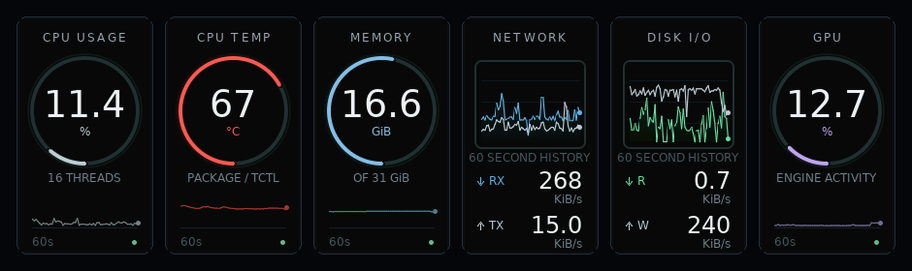
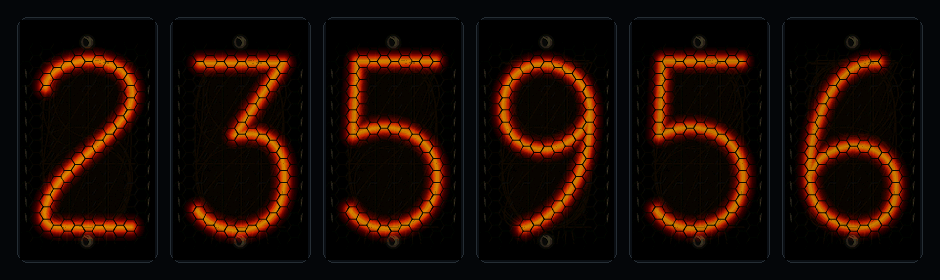
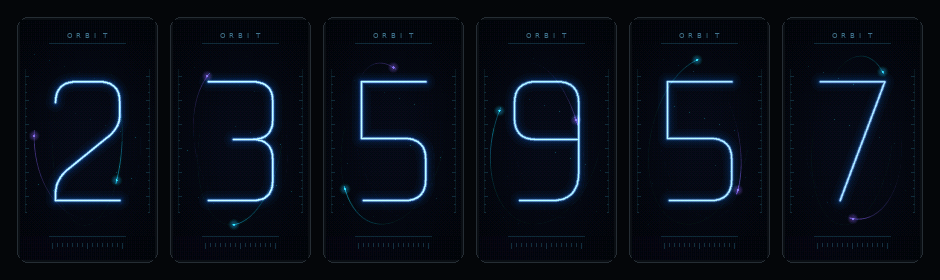

# ELEKSTUBE IPS PRO system monitor

Turn an ELEKSTUBE IPS PRO into a Linux system monitor and a six-tube animated
clock. Stats travel over USB or Wi-Fi; all clock animation runs on the ESP32.

**CPU usage · CPU temperature · memory · network · disk I/O · GPU**



The monitor has anti-aliased gauges, sixty-sample history graphs, and separate
receive/send and read/write traces. Press **A** to cycle through three clock
faces, each showing **24-hour H H M M S S** time:

### Nixie

Simulated orange-red cathodes, a honeycomb anode cage, faint inactive numerals,
breathing light, and an ignition flare when digits change. The artwork is
procedural, inspired by the stock Nixie face; no stock face images are included.



### Flip

Charcoal split cards with ivory numerals, hinges, perspective folding, cast
shadows, and a damped landing bounce. Settled cards stop redrawing.


### Orbit

An original instrument face with cyan numerals, precessing orbital rings,
satellites and luminous trails, twinkling stars, and a dissolving light-sweep
transition. DMA overlaps rendering and display transfers to deliver roughly
**14 complete six-tube frames per second** at 240 MHz CPU / 40 MHz SPI.



These previews use the same C++ renderers as the device. Actual framebuffer
captures are also included in [docs](docs/).

## Hardware and requirements

Tested on **ELEKSTUBE IPS PRO / Gen3 PCB 4.3.3**, with an **ESP32-PICO-D4**,
4 MiB flash, a CH340 USB serial adapter, and six 135 × 240 ST7789 displays.
Other ELEKSTUBE models and board revisions are unverified. GPIO 9/10 use is
specific to this hardware; this firmware is unsuitable for a generic ESP32 board.

The host needs Linux, Python **3.10+** (tested with 3.12), and access to its USB
serial port or the clock's LAN endpoint. Firmware development additionally needs
PlatformIO and `g++` for the native checks. Generated fonts and artwork are
committed, so normal builds do not require Pillow or font generation.

This firmware replaces the stock application, including its UI, weather and
face selection. **Back up your own clock before installing. Flash only the
application at `0x10000`; do not use `pio run -t upload` or erase-flash.**
Follow the [backup and installation guide](docs/installation.md) first.

## Run the monitor

After installing the firmware:

```sh
git clone https://github.com/mspellecacy/elekstube_sys.git
cd elekstube_sys
python3 -m venv .venv
.venv/bin/pip install -r requirements.txt

# Inspect local metrics without contacting the clock.
.venv/bin/python monitor.py sample

# Check the device and start sending stats once per second.
.venv/bin/python monitor.py probe
.venv/bin/python monitor.py run
```

The USB default is `/dev/serial/by-id/usb-1a86_USB_Serial-if00-port0`.
Choose another device with `--port /dev/ttyUSB0`. The host waits for each
acknowledgment and reconnects automatically if the connection drops.

### Use Wi-Fi

Connect by USB for initial pairing. Stop any running monitor process or service,
then run:

```sh
.venv/bin/python monitor.py configure-wifi
.venv/bin/python monitor.py run
```

Pairing reuses the Wi-Fi settings retained from the stock firmware, creates an
authentication token, and saves a private `config.json`. Subsequent runs use
`tcp://elekstube-monitor.local:32100`, falling back to the working IP address
during pairing if mDNS is unavailable. To choose a different network:

```sh
.venv/bin/python monitor.py configure-wifi --ssid "YOUR NETWORK"
```

The tool prompts for a hidden password. The clock uses **2.4 GHz Wi-Fi**; the
PC can use Ethernet or Wi-Fi as long as they can reach each other on the LAN.
After pairing, the clock can run from a USB wall power supply. Firmware flashing,
pairing and pixel capture still require USB.

The TCP connection authenticates the sender but is **not encrypted**. Keep it on
a trusted LAN; do not expose port 32100 to the Internet. Pairing config and flash
backups contain private device data and are excluded from Git.

### Start at login

On Linux with systemd, install the user service from your current checkout:

```sh
.venv/bin/python tools/install_service.py
systemctl --user status elekstube-monitor.service
journalctl --user -u elekstube-monitor.service -n 20
```

The installer fills in your checkout's paths and enables the service. It can
preview the unit with `--print`. Re-run it after moving the checkout, then restart
the service. Stop the service before manual access or firmware flashing:

```sh
systemctl --user stop elekstube-monitor.service
systemctl --user start elekstube-monitor.service
# To disable automatic startup:
systemctl --user disable --now elekstube-monitor.service
```

Only one process should send stats at a time. The clock accepts one TCP client.

## Controls and behavior

| Button | Action |
| --- | --- |
| A | Monitor → Nixie → flip → Orbit → monitor |
| D | Blank/unblank the displays |
| B / C | Unassigned |

The device starts in monitor mode. Host updates set the local time and continue
collecting graph history in every clock view. After six seconds without data,
the monitor shows `HOST OFFLINE`; a synchronized clock keeps ticking and animating
while powered. After a device restart it needs a new host update to set the time.
The PC must remain awake with the sender running for live stats. Base RGB LEDs
are off.

## Development

```sh
.venv/bin/pip install -r requirements-build.txt
.venv/bin/python -m unittest discover -s tests -v
.venv/bin/pio run
```

The checks cover telemetry accounting, transport framing and authentication,
private config handling, clock/button state, and all three C++ renderers under
AddressSanitizer and UndefinedBehaviorSanitizer. CI runs the checks and builds
the application. It never flashes a device.

- [Installation, backup and recovery](docs/installation.md)
- [Architecture, measurements and artwork tools](docs/development.md)
- [USB and TCP protocol](docs/protocol.md)

## Credits

The hardware pin map follows the V2 target in
[judge2005/EleksTubeIPS](https://github.com/judge2005/EleksTubeIPS/tree/v1.9.5).
This monitor and its procedural clock faces are an independent implementation,
not an official ELEKS product. No vendor firmware or device backups are distributed.

Firmware dependencies are [TFT_eSPI](https://github.com/Bodmer/TFT_eSPI),
[ArduinoJson](https://github.com/bblanchon/ArduinoJson), and
[Adafruit NeoPixel](https://github.com/adafruit/Adafruit_NeoPixel), with their own
upstream licenses. Embedded font data is derived from DejaVu Sans; its notices
and license are in [FONT-LICENSE.txt](FONT-LICENSE.txt).
